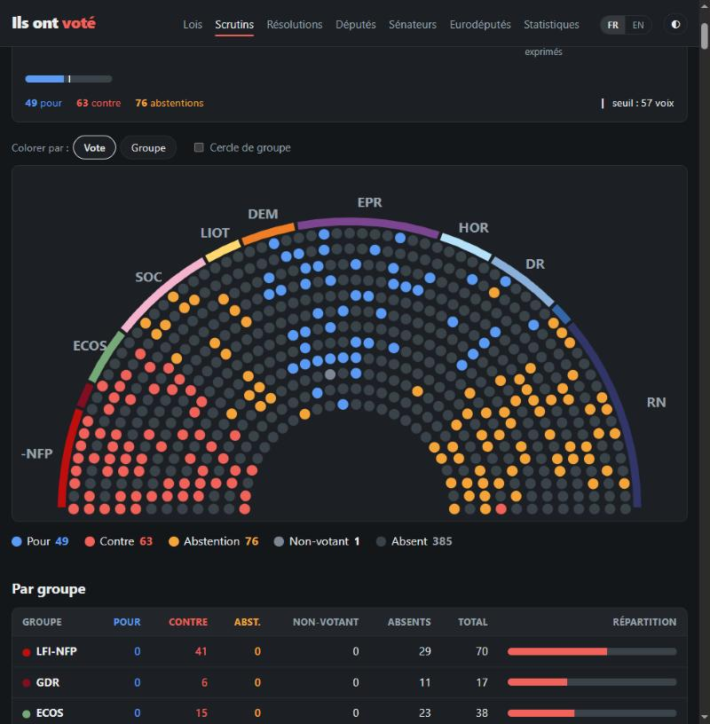

# Ils ont voté

**Qui a voté quoi ?** Voyez comment chaque député, sénateur et eurodéputé a voté sur chaque texte : un hémicycle avec un point par élu (pour, contre, abstention, absent), puis ce que devient le texte.

Site : <https://www.ilsontvote.org> · English version: [README.md](README.md)

<p align="center">
  
  
</p>

## Fonctionnalités

- **Un hémicycle par vote** : un point par élu, coloré par vote ou par groupe politique.
- **Trois assemblées** : Assemblée nationale (depuis 2017), Sénat (depuis 2006), Parlement européen (mandature en cours).
- **Cycle de vie d'une loi** : votes dans chaque chambre, promulgation, parution au Journal officiel, décision du Conseil constitutionnel.
- **Une page par élu** : historique de vote et participation.
- **« Absent » veut dire absent** : aucune raison affichée, le site ne juge pas.
- **Le doute et les données manquantes se voient toujours** : décomptes incomplets, valeurs calculées et sources tierces sont signalés (voir la [méthodologie](https://www.ilsontvote.org/methodologie)).
- Listes triables, export CSV/JSON, affichage adapté au téléphone, espace d'administration avec statistiques.
- **Données ouvertes** : tous les jeux de données (votes, élus, textes) en CSV compressés téléchargeables, régénérés chaque nuit (`/donnees`).

Seuls les **scrutins publics** enregistrent le vote de chaque élu ; les votes à main levée apparaissent sans le détail de qui a voté quoi, et le site le dit.

## Serveur MCP

Les assistants IA peuvent interroger les données (lecture seule, sans clé) sur `https://www.ilsontvote.org/mcp`. Voir [docs/MCP.fr.md](docs/MCP.fr.md).

## Sources de données

| Assemblée | Source |
|---|---|
| Assemblée nationale | [data.assemblee-nationale.fr](https://data.assemblee-nationale.fr/) (données ouvertes) |
| Sénat | [data.senat.fr](https://data.senat.fr/) (données ouvertes) |
| Parlement européen | [HowTheyVote.eu](https://howtheyvote.eu/), données sous [Open Database License](https://opendatacommons.org/licenses/odbl/1-0/) (ODbL) |

Les données de HowTheyVote.eu restent sous ODbL : citer la source et partager les bases dérivées sous la même licence.
Leurs photos et résumés de votes ne sont pas couverts par cette licence et ne sont pas utilisés.

## Technique

ASP.NET Core 10 Razor Pages · Dapper + Npgsql (tout l'accès aux données, SQL brut) · PostgreSQL · ASP.NET Identity (EF Core, uniquement pour l'authentification, sans migrations EF : les tables sont créées en SQL) · un importeur console lancé chaque nuit par un timer systemd.

## Lancer en local

Prérequis : SDK .NET 10, PostgreSQL.

```bash
# 1. Base de données (adapter noms et port)
createdb ilsontvote
for f in db/0*.sql; do psql -d ilsontvote -v ON_ERROR_STOP=1 -f "$f"; done

# 2. Paramètres (ne jamais les commiter : appsettings.Development.json est ignoré par Git)
cp src/IlsOntVote.Web/appsettings.Development.example.json src/IlsOntVote.Web/appsettings.Development.json
cp src/IlsOntVote.Importer/appsettings.Development.example.json src/IlsOntVote.Importer/appsettings.Development.json
# modifier les deux : chaîne de connexion, e-mail et mot de passe administrateur (12 caractères, dont un symbole)

# 3. Importer les données (long la première fois)
cd src/IlsOntVote.Importer
DOTNET_ENVIRONMENT=Development dotnet run -- an --legislature all
DOTNET_ENVIRONMENT=Development dotnet run -- senat
DOTNET_ENVIRONMENT=Development dotnet run -- textes
DOTNET_ENVIRONMENT=Development dotnet run -- ue            # incrémental ; --limit N pour tester

# 4. Site
cd ../IlsOntVote.Web && dotnet run
```

## Déploiement

Ubuntu, nginx en reverse proxy, service systemd et timer d'import. Les scripts sont dans [`deploy/`](deploy/) ; la procédure est dans [DEPLOYMENT_SITE.fr.md](DEPLOYMENT_SITE.fr.md). Les secrets ne sont que dans `appsettings.Local.json` sur le serveur, jamais dans le dépôt.

## Règles du projet

- Toute modification de schéma est une **nouvelle migration numérotée** dans `db/` ; une migration appliquée ne se réécrit jamais.
- Un seul jeu de couleurs de vote partout (pour = bleu, contre = rouge, abstention = orange, non-votant = gris, absent = gris clair).
- Textes publics en français ; les commentaires du code expliquent le *pourquoi* (en français).

## Contribuer

Les issues et pull requests sont bienvenues, surtout les signalements de qualité des données (avec le lien vers la source officielle) et les nouvelles sources.

## Licence

[GNU GPL v3.0](LICENSE) pour le code. Les données appartiennent à leurs éditeurs et gardent leurs licences (voir ci-dessus).
